<div align="center">

# 数字人微课平台

**海南大学数字人微课系统 · 前端页面原型**

从讲稿到成片的一站式数字人微课生产工具


</div>

---

## 项目简介

面向高校教师的数字人微课生产平台原型，把「写讲稿 → 生成 PPT → 配音 → 数字人口播 → 课件合成」串成一条完整工作流，让老师不用出镜、不用录音，也能批量产出标准化的课程视频。

项目共 **35 个页面**：7 个登录/找回密码页 + 28 个工作台页面，覆盖从账号体系到内容生产、资源管理的完整闭环。

## 界面预览

| 工作台 | 微课智能体 |
|:---:|:---:|
| 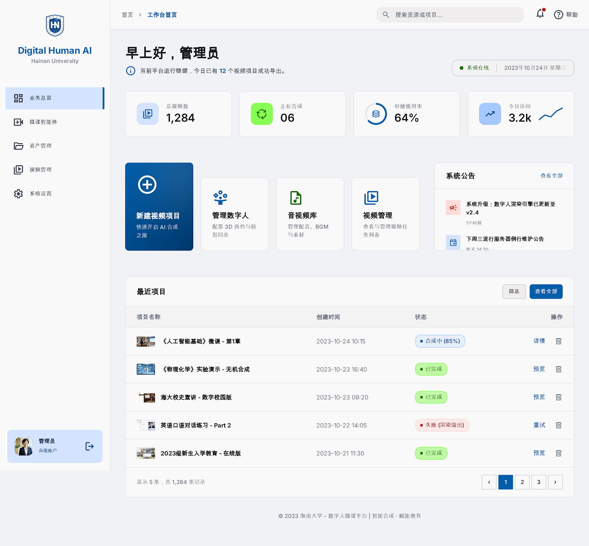 | 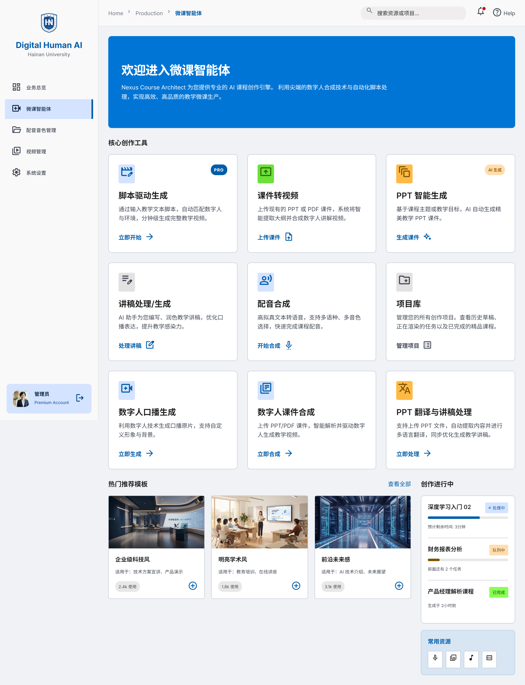 |

| 脚本生成 | 数字人口播 |
|:---:|:---:|
| 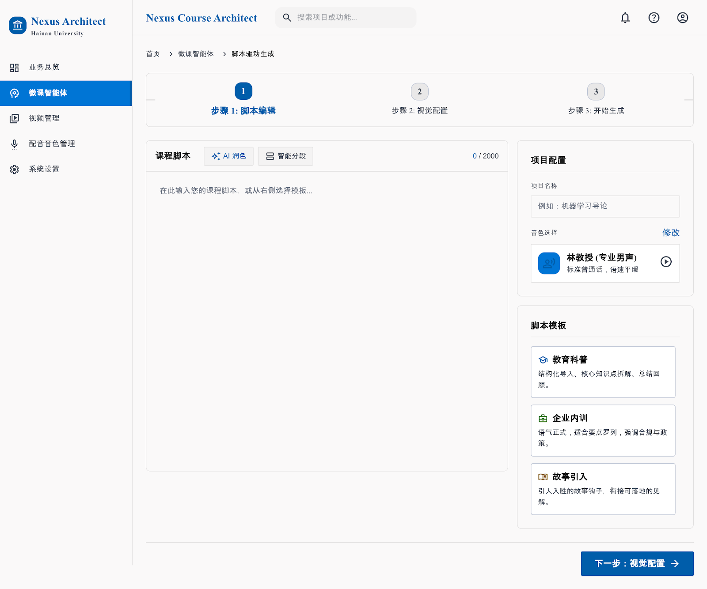 | 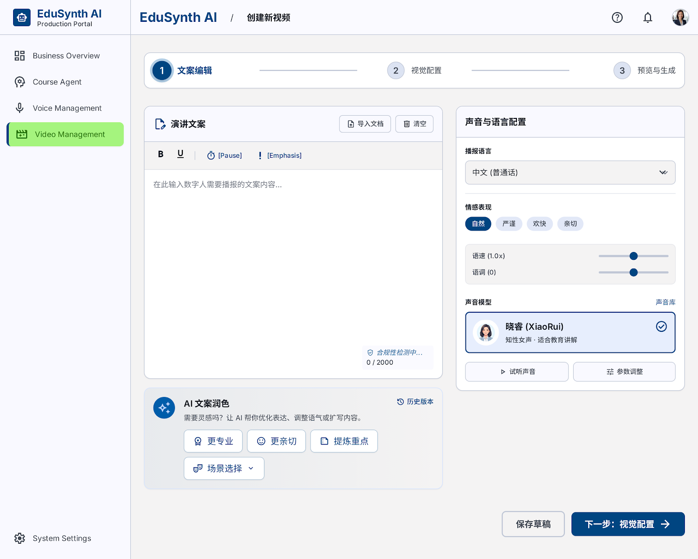 |

| 资产管理 | 项目库 |
|:---:|:---:|
| 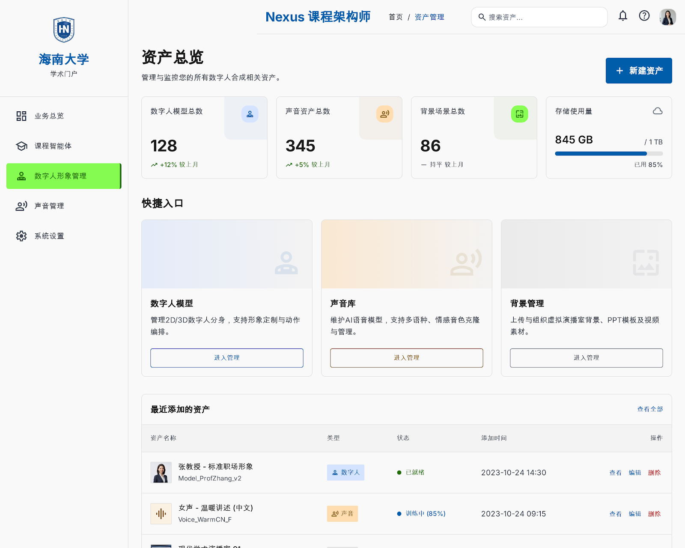 | 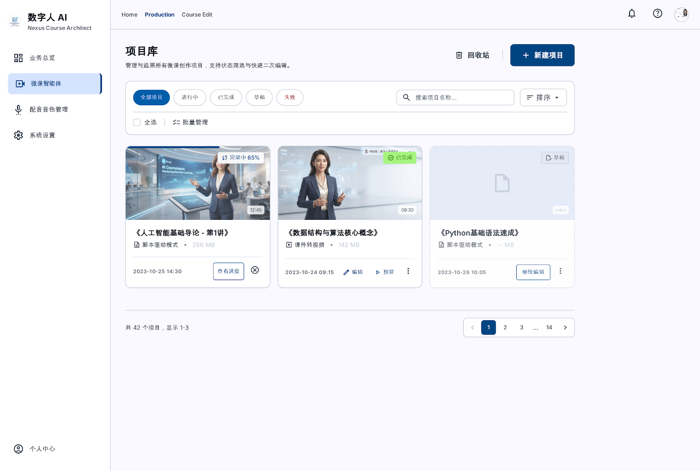 |

<details>
<summary>展开更多页面截图</summary>

| 登录 | 数字人形象配置 |
|:---:|:---:|
| 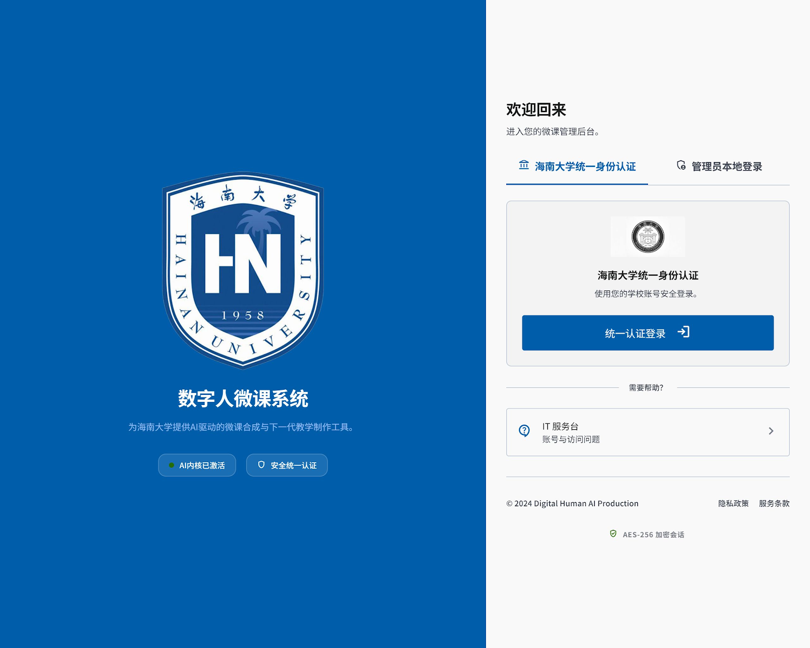 |  |

| PPT 智能生成 | 声音库 |
|:---:|:---:|
| 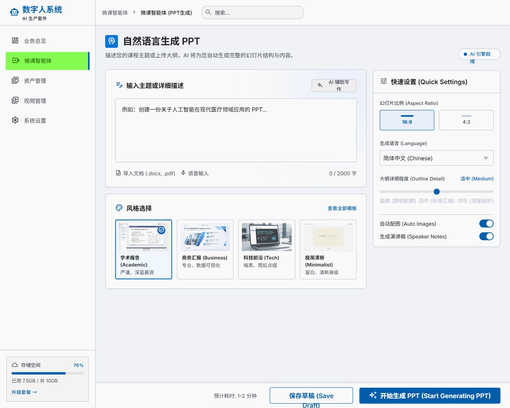 | 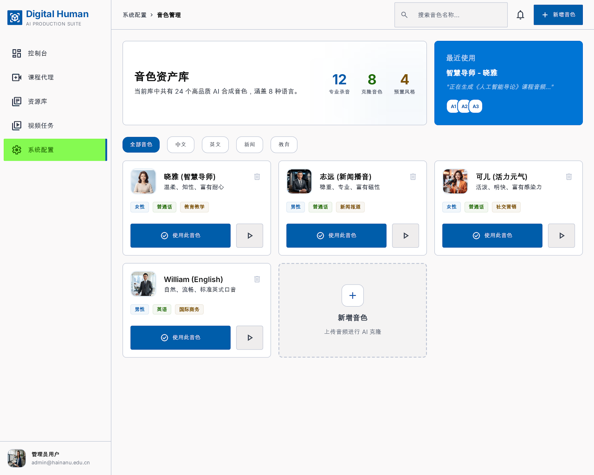 |

| 视频管理 | 合成任务 |
|:---:|:---:|
| 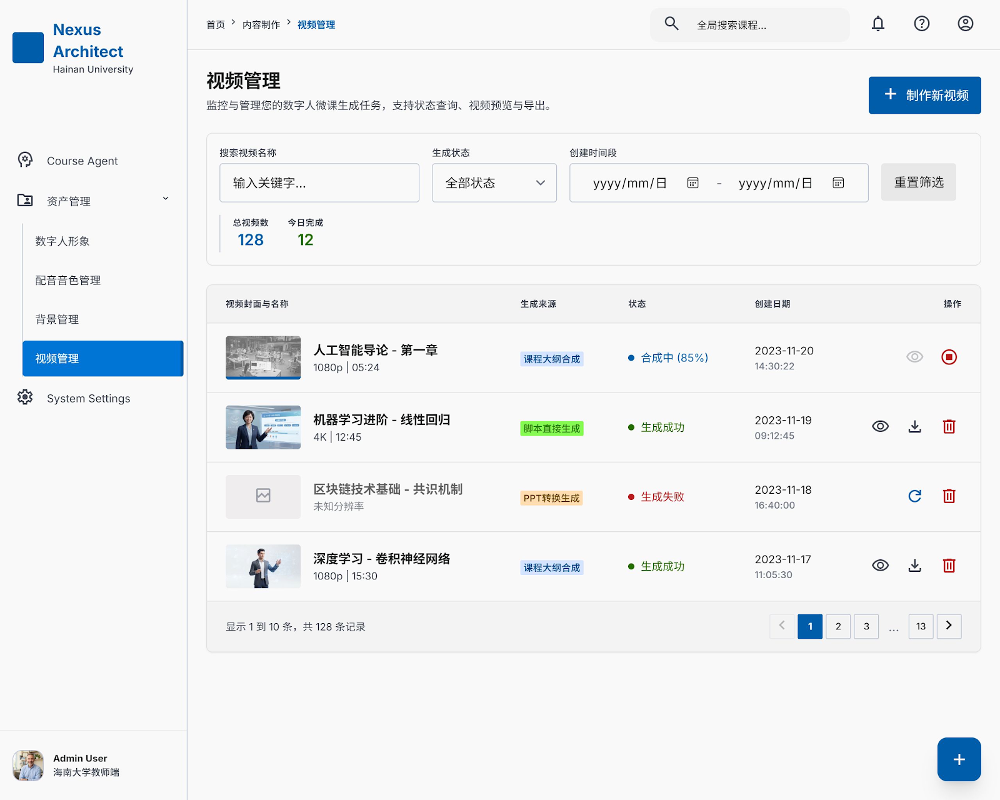 | 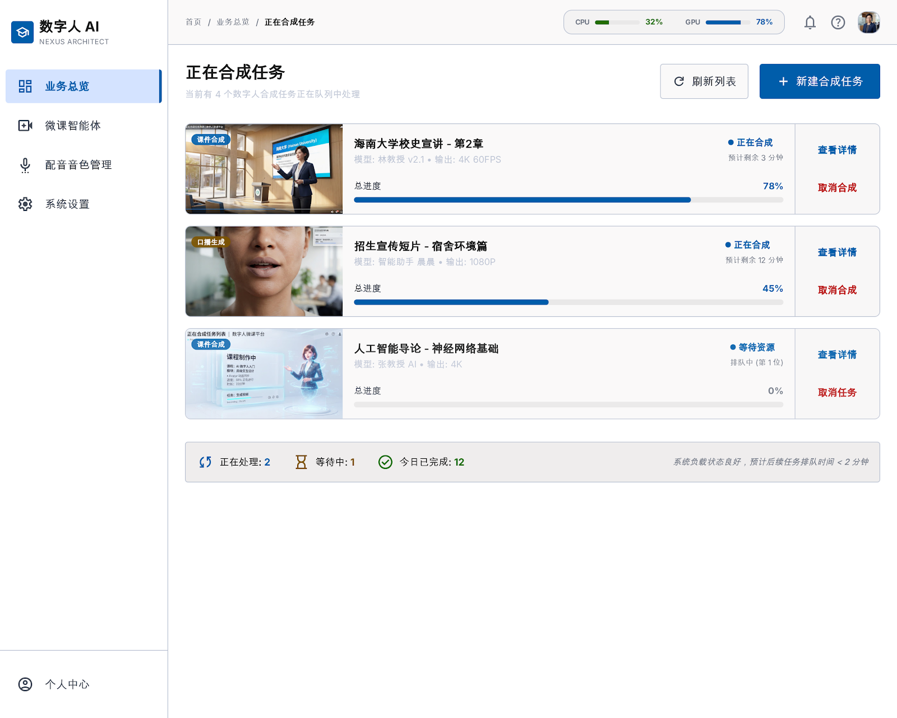 |

</details>

## 功能模块

### 登录与账号（7 页）

| 页面 | 说明 |
| --- | --- |
| 登录入口 / 账号登录 / 扫码登录 | 三种登录方式，支持海南大学统一身份认证入口 |
| 管理员登录 | 独立的管理后台入口 |
| 找回密码（3 步） | 验证账号 → 验证身份 → 设置新密码 |

### 内容创作（11 页）

| 页面 | 说明 |
| --- | --- |
| 新建讲稿 / 讲稿处理 | 讲稿录入、分段、润色与生成 |
| **微课智能体** | 对话式生成课程内容，Vue 3 驱动 |
| **脚本生成** | 按知识点生成分镜脚本，Vue 3 驱动 |
| PPT 智能生成 | 根据讲稿自动生成课件页面 |
| PPT 翻译与讲稿处理 | 多语言课件翻译 |
| 音频生成 / 语音合成 | 文本转语音、音色选择、语速调节 |
| 数字人口播生成 | 选择形象与音色，生成口播视频 |
| 数字人课件合成 | 合并课件画面与数字人画面 |
| 课件转视频 | 已有课件转成视频 |
| 新建视频项目 | 项目初始化与参数配置 |

### 数字人管理（5 页）

新增数字人、数字人模型管理、形象配置、角色进阶编辑、口播生成。

### 资源与项目（6 页）

资产管理、背景管理、声音库、视频管理、项目库、回收站——统一支持视图切换、分组筛选、批量操作与完整操作菜单。

### 系统（3 页）

消息中心、帮助中心、系统设置。

## 技术栈

| 分类 | 选型 |
| --- | --- |
| 页面 | 原生 HTML5，无前端框架构建流程 |
| 样式 | Tailwind CSS 3（独立版 CLI 编译），自定义设计令牌 |
| 交互 | 原生 JavaScript；`微课智能体` 与 `脚本生成` 两页使用 Vue 3（CDN） |
| 图标与字体 | Material Symbols、Inter（本地托管，不依赖外网） |
| 接口层 | `assets/js/ppt-app.js` 封装 `/api/v1` 客户端，含超时与中断控制 |

## 目录结构

```
shuziren/
├── Login/                       # 登录与找回密码
│   ├── login/                   # 入口、账号、扫码、管理员
│   ├── forgot-password/         # 三步找回密码
│   └── DESIGN.md                # 设计令牌
├── dashboard/                   # 工作台（28 页）
│   ├── index.html               # 工作台首页
│   ├── micro-lecture-agent.html # 微课智能体
│   ├── script-generation.html   # 脚本生成
│   ├── digital-human-*.html     # 数字人相关
│   ├── ppt-*.html               # PPT / 音频处理
│   ├── *-screen.png             # 各页面截图
│   └── DESIGN.md
├── assets/
│   ├── css/                     # 设计令牌、Tailwind 产物
│   ├── js/                      # 业务脚本（ppt-app / ppt-audio / ppt-translation）
│   ├── fonts/                   # Inter、Material Symbols
│   └── images/
└── tailwind.config.js           # 颜色、字体、间距令牌
```

## 本地运行

页面是纯静态的，直接打开即可：

```bash
# 方式一：直接用浏览器打开
start dashboard/index.html

# 方式二：起一个本地静态服务（推荐，相对路径与后续接后端都更方便）
python -m http.server 8080
# 访问 http://localhost:8080/dashboard/index.html
```

修改样式后重新编译 Tailwind（独立版 CLI，不依赖 Node）：

```bash
# 下载 https://github.com/tailwindlabs/tailwindcss/releases 的独立可执行文件
./tailwindcss.exe -i assets/css/input.css -o assets/css/tailwind.css --minify
```

## 说明

- 本仓库是**前端页面原型**，包含完整的界面、交互与页面流转；**不含后端服务**，页面数据为示例数据。
- API 客户端（`/api/v1`）已就绪，接入后端后即可替换为真实数据。
- 视觉遵循 Material Design 3 设计令牌，配色、字体与间距集中在 `tailwind.config.js` 与 `DESIGN.md` 中定义。

---

<div align="center">

海南大学 · 软件工程

</div>
